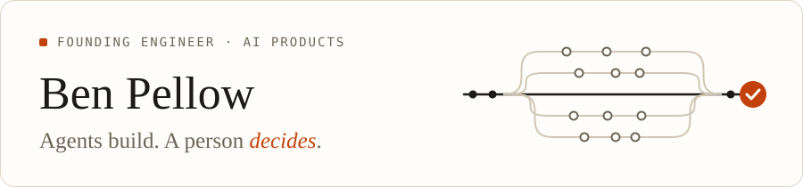

  <picture>
    <source media="(max-width: 700px) and (prefers-color-scheme: dark)" srcset="assets/banner-mobile-dark.svg">
    <source media="(max-width: 700px)" srcset="assets/banner-mobile-light.svg">
    <source media="(prefers-color-scheme: dark)" srcset="assets/banner-dark.svg">
    
  </picture>

  <picture>
    <source media="(max-width: 700px) and (prefers-color-scheme: dark)" srcset="assets/tagline-mobile-dark.svg">
    <source media="(max-width: 700px)" srcset="assets/tagline-mobile-light.svg">
    <source media="(prefers-color-scheme: dark)" srcset="assets/tagline-dark.svg">
    
  </picture>

**Hi, I'm Ben.** I build AI products with a team of coding agents, and the tools that keep a person in charge of what they ship.

### Agentic work

- **[Proofs](https://github.com/workingBen/proofs)**: a Claude Code plugin of 12 skills that make coding agents show their work before anything ships: design reviews with real mockups, visual QA at three screen sizes, copy edits with a claims check, and decision pages you answer from your phone. [See it work](https://workingben.github.io/proofs/).
- **How I work with agents**: several sessions run at once, each in its own git worktree. Every change gets a local CI gate before merge, and every visual change gets before/after screenshots I approve. Unattended runs open pull requests from a to-do list; a person merges them.

Most of this code lives in private repos. The activity graph counts it.

### Products built this way

- **[Low EMF Life](https://lowemf.life)**: a reporting platform for Building Biologists. AI turns voice and video notes from a home inspection into a finished report.
- **[Greensprings Longevity](https://greensprings.life)**: a habit tracker, a research library of evidence-based longevity protocols linked to the science, retreat bookings and client portals, including [The Device Stack Test](https://greensprings.life/device-stack-test) and [The Supplement Stack Test](https://greensprings.life/supplement-stack-test).

Before that: engineering manager at Amazon and Walmart Labs, and co-founder and CTO of CampusCred (YC S11).

[LinkedIn](https://www.linkedin.com/in/benpellow/)
